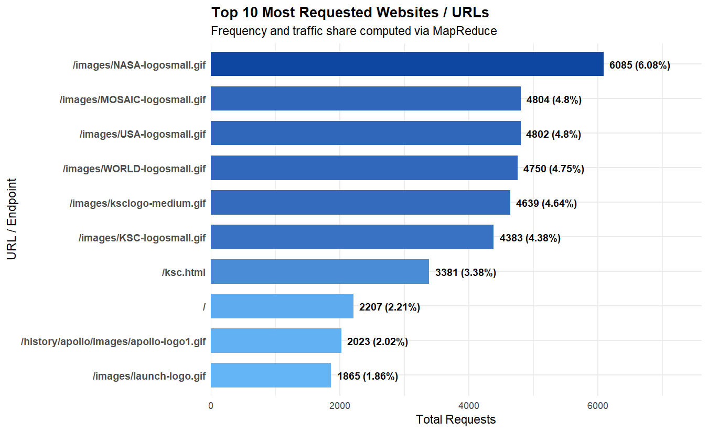
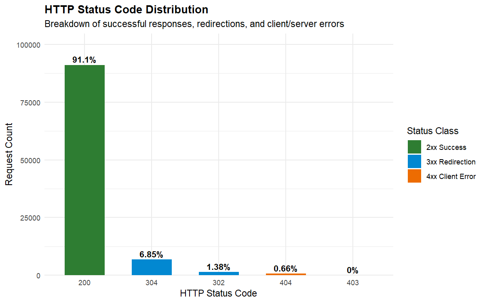
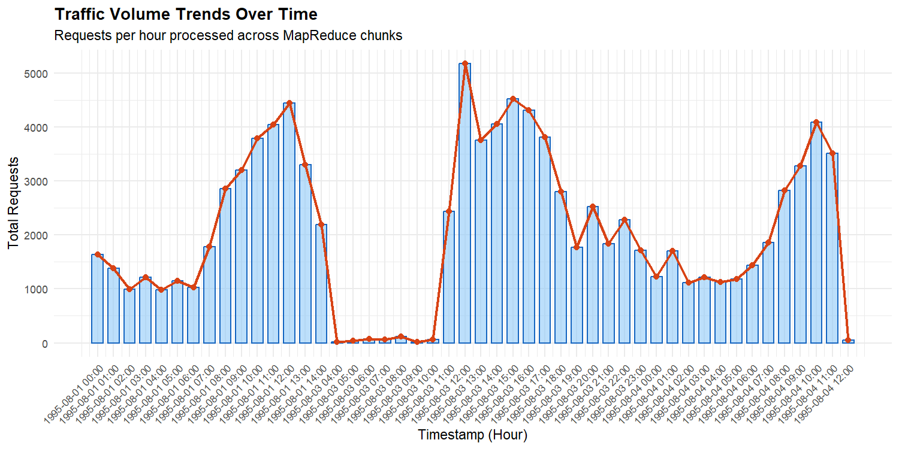
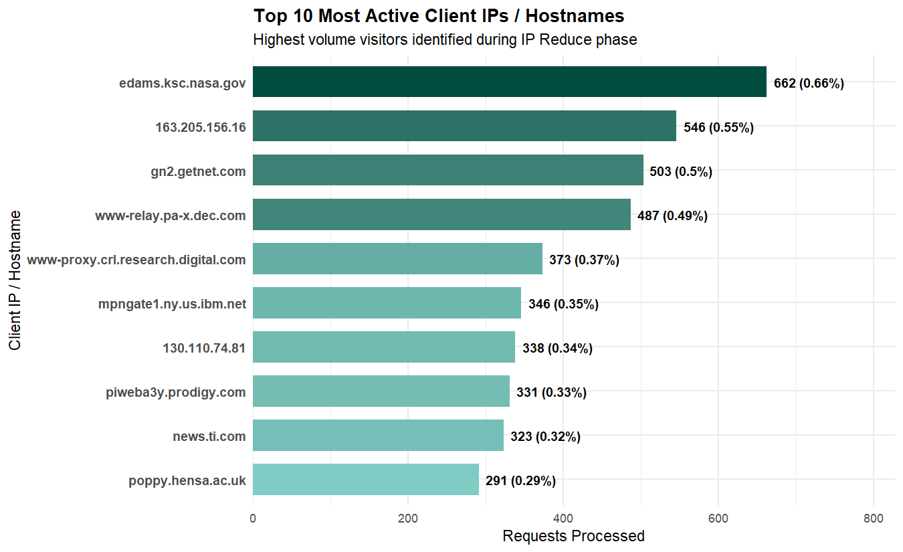
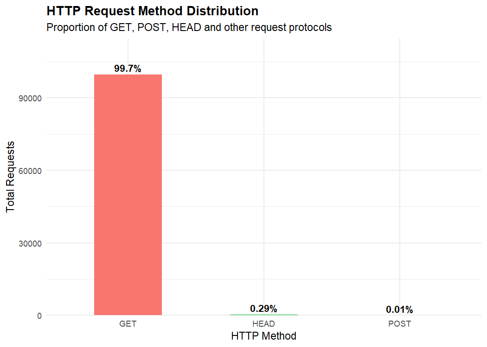

# TITLE PAGE

## WEBSITE LOG ANALYSIS USING MAPREDUCE IN R WITHOUT HADOOP

### Project Report

Submitted to  
**APJ Abdul Kalam Technological University (KTU)**

in partial fulfilment of the requirements for the award of the degree of

**Bachelor of Technology**  
**in Computer Science and Engineering**

Submitted by

**Student Name:** [NAME OF STUDENT]  
**Register Number:** [REGISTER NUMBER]

Under the guidance of

**Guide Name:** [NAME OF GUIDE]  
**Designation:** [DESIGNATION]

**Department of Computer Science and Engineering**  
**[NAME OF COLLEGE]**  
**[COLLEGE ADDRESS]**

**Academic Year: [20__–20__]**

\newpage

# CERTIFICATE

This is to certify that the project report entitled **“WEBSITE LOG ANALYSIS USING MAPREDUCE IN R WITHOUT HADOOP”** is a bonafide record of the project work carried out by **[NAME OF STUDENT]**, Register Number **[REGISTER NUMBER]**, under my guidance and supervision in partial fulfilment of the requirements for the award of the degree of Bachelor of Technology in Computer Science and Engineering under APJ Abdul Kalam Technological University.

The work presented in this report has been completed during the academic year **[20__–20__]** and has not been submitted, in whole or in part, for the award of any other degree or diploma.

|  |  |
|---|---|
| **Project Guide** | **Head of Department** |
| Signature: ____________________ | Signature: ____________________ |
| Name: [GUIDE NAME] | Name: [HOD NAME] |
| Date: [DATE] | Date: [DATE] |

**External Examiner 1:** ____________________  
**External Examiner 2:** ____________________  
**Date of Examination:** ____________________

\newpage

# DECLARATION

I, **[NAME OF STUDENT]**, Register Number **[REGISTER NUMBER]**, hereby declare that the project report entitled **“WEBSITE LOG ANALYSIS USING MAPREDUCE IN R WITHOUT HADOOP”** is my original work carried out under the supervision of **[GUIDE NAME]**, Department of Computer Science and Engineering, **[NAME OF COLLEGE]**.

I further declare that this report has not been submitted previously, either fully or partly, for the award of any degree, diploma, or other academic qualification. All external documentation and sources used in the report have been acknowledged in the References section.

**Place:** [PLACE]  
**Date:** [DATE]

**Signature of Student:** ____________________  
**Name:** [NAME OF STUDENT]

\newpage

# ACKNOWLEDGEMENT

I express my sincere gratitude to APJ Abdul Kalam Technological University and **[NAME OF COLLEGE]** for providing the academic environment and facilities required for this project.

I thank **[HOD NAME]**, Head of the Department of Computer Science and Engineering, for the encouragement and support provided during the work. I am deeply grateful to my project guide, **[GUIDE NAME]**, for valuable guidance, technical suggestions, review, and motivation throughout the project.

I also thank the teaching and technical staff of the department, my classmates, and my family for their assistance and encouragement. Finally, I acknowledge the open documentation and software communities whose verified resources supported the use of R, ggplot2, and the MapReduce programming model.

\newpage

# ABSTRACT

Website access logs contain a detailed history of requests received by a web server. They can be used to study traffic volume, frequently requested resources, client activity, response status codes, bandwidth consumption, time-based traffic patterns, and possible high-volume traffic behaviour. However, a multi-gigabyte log file cannot be safely loaded into memory on every personal computer. A memory-conscious processing method is therefore required.

This project presents a MapReduce-style website log analysis system implemented in R without Hadoop. The system reads an access log in chunks of 50,000 lines. Each chunk is parsed and validated, relevant fields are extracted, and intermediate key-value records are produced for URLs, client IP addresses, HTTP status codes, request methods, hourly traffic, and 404 resources. A grouping and sorting stage collects records with the same key, and a reduction stage aggregates request counts and response bytes. Reduced results from successive chunks are merged into global tables. The system also loads an IP-to-hostname dictionary from `client_hostname.csv`, exports analysis tables, and generates five charts using `ggplot2`.

The reported experiment processed 100,000 records in the current test, not the complete approximately 3.26 GB input dataset. All 100,000 records were valid and no malformed records were observed in that test. The test produced 2,793 unique URLs, 6,797 unique client IP addresses, 1,642.1 MB of served bandwidth, an average transfer of 17,218.68 bytes per request, and 665 HTTP 404 responses. The most requested URL was `/images/NASA-logosmall.gif` with 6,085 requests. HTTP 200 responses represented 91.10% of the test records, while GET requests represented 99.70%. The measured processing time was 5.59 seconds for this 100,000-record test.

The results demonstrate that chunk-based MapReduce-style processing is a practical educational approach for large log analysis on a single computer. Full-dataset processing, validation of all aggregates, full-run timing, and peak memory measurement remain pending and are identified as future work.

**Keywords:** Web log analysis, MapReduce, R programming, chunk processing, HTTP status codes, traffic analysis, ggplot2, Hadoop-free analytics.

\newpage

# TABLE OF CONTENTS

1. [Introduction](#chapter-1-introduction)  
2. [Problem Statement and Objectives](#chapter-2-problem-statement-and-objectives)  
3. [Literature Review and Existing System](#chapter-3-literature-review-and-existing-system)  
4. [System Requirements and Design](#chapter-4-system-requirements-and-design)  
5. [Methodology and Implementation](#chapter-5-methodology-and-implementation)  
6. [Results and Discussion](#chapter-6-results-and-discussion)  
7. [Testing and Performance Analysis](#chapter-7-testing-and-performance-analysis)  
8. [Conclusion and Future Scope](#chapter-8-conclusion-and-future-scope)  
9. [References](#references)  
10. [Appendices](#appendices)

# LIST OF FIGURES

**Figure 4.1** System architecture  
**Figure 4.2** Data flow diagram  
**Figure 5.1** MapReduce-style processing sequence  
**Figure 6.1** Top requested URLs  
**Figure 6.2** HTTP status code distribution  
**Figure 6.3** Traffic trends by hour  
**Figure 6.4** Top client IP addresses and hostnames  
**Figure 6.5** HTTP request method distribution

# LIST OF TABLES

**Table 2.1** Project objectives  
**Table 4.1** Functional requirements  
**Table 4.2** Non-functional requirements  
**Table 4.3** Input and output artefacts  
**Table 6.1** KPI summary for the current test  
**Table 6.2** Top ten requested URLs  
**Table 6.3** Top ten client IP addresses  
**Table 6.4** HTTP status code distribution  
**Table 6.5** HTTP method distribution  
**Table 6.6** Top 404 resources  
**Table 7.1** Test cases and expected behaviour

\newpage

# Chapter 1: Introduction

## 1.1 Background

Every request sent to a web server can create an access-log record. A typical record contains the client address, date and time, request method, requested resource, protocol, response status, and response size. Over time, these records form a valuable operational dataset. A log can show which pages are popular, when the server receives the greatest load, how much data is served, and which resources frequently fail.

Website log analysis converts raw text into structured evidence. Instead of inspecting individual lines manually, an analysis system groups records by meaningful keys and calculates totals. The resulting tables can support capacity planning, content improvement, error correction, and investigation of unusual traffic patterns.

The dataset considered by this project is an approximately 3.26 GB `access.log` file. Such a file is large enough to expose the limitations of naive full-file loading. The project therefore uses a streaming reader and processes only a fixed-size chunk at a time.

## 1.2 Importance of Web Server Log Analysis

Log analysis is useful for several reasons:

1. **Traffic measurement:** Request counts show the level of activity received by the server.
2. **Resource popularity:** URL rankings help identify frequently used pages, images, and other resources.
3. **Server performance:** Response sizes and hourly volumes provide indicators of bandwidth demand.
4. **Error monitoring:** 4xx responses identify missing or restricted resources, while 5xx responses would indicate server-side failures when present.
5. **Client activity:** IP and hostname summaries show which clients generated the largest number of requests.
6. **Operational investigation:** Concentrated request volume can be marked for further investigation.

High request volume alone is not proof of malicious activity. A popular proxy, crawler, cache, or automated client may legitimately generate many requests. The system therefore reports anomaly indicators as investigation aids, not as confirmed security findings.

## 1.3 Big Data Processing Context

Big data processing is concerned with data volume, velocity, variety, and the practical difficulty of obtaining reliable results from large datasets. A log file is primarily a volume and processing problem: it is sequential, repetitive, and potentially too large for convenient in-memory analysis.

The MapReduce model provides a useful way to express aggregation. A map operation transforms each input record into intermediate key-value pairs. A grouping or shuffle operation brings equal keys together. A reduce operation combines the values associated with each key. The model is commonly associated with distributed systems, but its conceptual stages can also be implemented sequentially on one computer.

## 1.4 Chunk-Based Processing

In this project, the input connection is read using `readLines()` with a chunk size of 50,000 lines. The current test follows this sequence:

1. Read at most 50,000 raw lines.
2. Parse and validate that chunk.
3. Map valid records into metric-specific key-value tables.
4. Group and sort the intermediate keys.
5. Reduce each group to request and byte totals.
6. Merge the reduced chunk tables into a global accumulator.
7. Repeat until the configured test limit or end of file.

Chunk processing prevents the entire raw file from becoming one R object. It does not remove all memory use: the global aggregate tables and hostname dictionary remain in memory. Therefore, the report describes the approach as memory-conscious and chunk-based rather than claiming a measured constant memory bound.

## 1.5 Motivation for R Without Hadoop

Hadoop is designed for distributed storage and computation, but a Hadoop installation introduces cluster, Java, configuration, and administration requirements. This project has an educational objective: to demonstrate the MapReduce stages and large-file aggregation logic using R on a standalone computer. R provides convenient data structures, date handling, statistical operations, and plotting. Avoiding Hadoop also makes the project easier to run in a college laboratory or on a personal workstation.

The phrase “without Hadoop” is important. The implementation is not a Hadoop job and does not provide distributed execution, HDFS storage, task scheduling, or Hadoop fault tolerance. It is a local R implementation inspired by the MapReduce programming model.

## 1.6 Organization of the Report

Chapter 2 defines the problem, objectives, scope, and expected outcomes. Chapter 3 discusses general approaches and the proposed system without inventing unsupported research claims. Chapter 4 presents requirements and design. Chapter 5 explains the implementation modules and processing stages. Chapter 6 reports the measured 100,000-record results. Chapter 7 discusses testing and performance limitations. Chapter 8 concludes the work and lists future improvements.

\newpage

# Chapter 2: Problem Statement and Objectives

## 2.1 Problem Definition

The project addresses the following problem:

> How can a large website access log be analysed for traffic, client activity, HTTP response behaviour, bandwidth, and possible high-volume anomalies when the complete file should not be loaded into memory and a Hadoop cluster is not available?

The proposed solution must preserve relevant fields, reject malformed records explicitly, aggregate data across chunks correctly, and produce readable tables and visualizations.

## 2.2 Need for Memory-Conscious Processing

A full-file import may require more memory than the raw file size because strings, vectors, data frames, and intermediate copies have implementation overhead. It can also prevent other applications from running and may fail before analysis begins. Reading 50,000 lines at a time limits the raw input retained during each iteration and allows aggregation to proceed progressively.

The design also separates raw records from reduced results. Raw lines are used only for the current chunk. The global state stores summaries such as URL counts, IP counts, status counts, hourly counts, method counts, and 404 counts.

## 2.3 Objectives

| No. | Objective |
|---:|---|
| 1 | Read a large access log incrementally in chunks of 50,000 lines. |
| 2 | Parse the log format and extract IP, timestamp, method, URL, status, and response size. |
| 3 | Count valid and malformed records explicitly. |
| 4 | Implement MapReduce-style map, grouping/shuffle, reduce, and cross-chunk merge stages in R. |
| 5 | Load IP-to-hostname mappings from `client_hostname.csv`. |
| 6 | Calculate URL, client, status, method, hourly, bandwidth, and 404-resource summaries. |
| 7 | Identify high-volume client indicators for administrative investigation. |
| 8 | Export analysis tables as CSV files. |
| 9 | Generate five charts using `ggplot2` when available. |
| 10 | Validate parsing, mapping, grouping, reduction, and multi-chunk merging with tests. |

## 2.4 Scope

The scope includes Common Log Format and Combined Log Format detection, regular-expression parsing, missing byte handling, request aggregation, hostname enrichment, table export, and chart generation. The implementation is designed for a local file and sequential chunk processing.

The scope does not include distributed processing, real-time log ingestion, authentication analysis, content inspection, network packet capture, confirmed intrusion detection, geographic IP analysis, or complete validation of the approximately 3.26 GB file. The current measured results are explicitly limited to 100,000 records.

## 2.5 Expected Outcomes

The expected outputs are:

- a validated count of records read, valid records, and malformed records;
- ranked URL and client summaries;
- status-code and method distributions;
- hourly request and bandwidth tables;
- top missing resources;
- high-volume client indicators;
- eight CSV analysis files;
- five PNG visualizations;
- a reproducible R execution procedure.

\newpage

# Chapter 3: Literature Review and Existing System

## 3.1 General Approaches to Web Log Analysis

Web log analysis commonly begins with format parsing. The parser identifies fields from a known log format, converts dates and numeric fields, and handles missing values. Descriptive aggregation is then used to count requests by URL, IP, status, method, and time period. Visualization makes the aggregate patterns easier to interpret.

For small files, an analyst may load the complete dataset into a data frame and use filtering, grouping, and plotting functions. This approach is simple but becomes less suitable as the file grows. For larger workloads, systems may use database ingestion, distributed processing frameworks, stream processors, or specialized log-analysis platforms.

## 3.2 MapReduce as a Processing Model

The MapReduce model describes a computation as a map function that emits intermediate key-value pairs and a reduce function that combines values for equal keys. A runtime may perform partitioning, sorting, scheduling, and failure recovery. In a distributed implementation, these services are important because data and computation are spread across machines.

This project uses the conceptual stages only. R functions in `mapper.R`, `shuffle.R`, and `reducer.R` make the stages visible and testable, while `main.R` controls chunk iteration. There is no claim that the project reproduces Hadoop's distributed runtime.

## 3.3 Challenges of Large Log Files

The main challenges are:

- **Memory pressure:** Raw lines and parsed columns can occupy more memory than expected.
- **Irregular records:** A malformed line may break a simple delimiter-based reader.
- **Missing numeric values:** A hyphen in the byte field cannot be summed until it is represented numerically.
- **Aggregation across chunks:** A correct total must combine keys that appear in different chunks.
- **Data enrichment:** Hostname mappings add useful context but also require memory and lookup handling.
- **Result interpretation:** A frequent client or resource is an indicator, not automatically a fault or attack.

## 3.4 Existing Approaches and Limitations

| Approach | Strength | Limitation for this project |
|---|---|---|
| Full in-memory R import | Simple and flexible | May exceed available memory for multi-gigabyte files |
| Relational database import | Supports querying and indexing | Requires schema, loading time, and database setup |
| Hadoop MapReduce | Distributed storage and execution | Requires a cluster-oriented environment and administration |
| Spark or similar framework | Fast distributed analytics | Adds runtime and deployment requirements |
| Manual inspection | Useful for a few records | Cannot summarize millions of records reliably |
| Local chunked R pipeline | Low setup cost and memory-conscious | Sequential; no distributed fault tolerance or parallel execution |

## 3.5 Proposed System and Advantages

The proposed system combines the readability of R with a chunked aggregation workflow. It is appropriate for a laboratory project because each processing stage is represented by a separate source file and can be verified with focused tests. The system also creates reusable CSV outputs and PNG plots, so the results can be inspected without re-reading the raw log.

The principal advantages are:

1. no Hadoop cluster is required;
2. raw input is read incrementally;
3. malformed records are counted rather than silently ignored;
4. aggregation logic is separated into map, shuffle, and reduce modules;
5. hostname enrichment is supported through a lookup environment;
6. the output is reproducible and easy to share.

## 3.6 Limitations of the Proposed System

The system is not a distributed MapReduce engine. Chunks are processed sequentially, and global reduced tables grow with the number of unique keys. The present experiment stops at 100,000 records, so the full approximately 3.26 GB dataset has not yet been validated. These limitations are addressed explicitly in Chapters 6–8.

\newpage

# Chapter 4: System Requirements and Design

## 4.1 Hardware Requirements

The following details must be completed from the actual execution machine before final submission:

| Component | Requirement or recorded value |
|---|---|
| Processor | [PROCESSOR MODEL / CORE COUNT] |
| Main memory | [RAM CAPACITY] |
| Storage | [DRIVE TYPE AND FREE SPACE] |
| Operating system | [WINDOWS / LINUX / VERSION] |
| Display | [OPTIONAL] |

No unverified hardware specification is claimed in this report.

## 4.2 Software Requirements

| Software | Use |
|---|---|
| R | Parsing, chunk reading, aggregation, reporting, and plotting |
| `ggplot2` | Generation of the five requested charts |
| `data.table` | Optional efficient CSV loading for the hostname dictionary |
| R base packages | File I/O, regular expressions, grouping, sorting, and reductions |
| Optional Shiny | Interactive display of exported results through `dashboard/app.R` |
| Windows or another supported desktop OS | Local execution environment |

The repository README identifies R 4.0 or later as the project prerequisite. The exact installed version used for the final college submission should be recorded in the placeholders or execution log.

## 4.3 Functional Requirements

| ID | Requirement |
|---|---|
| FR1 | Read the access log in chunks rather than loading it as one object. |
| FR2 | Detect CLF or Combined-style records and parse supported fields. |
| FR3 | Count valid and malformed records. |
| FR4 | Convert missing response bytes represented by `-` to zero for aggregation. |
| FR5 | Produce mapped streams for URLs, IPs, statuses, hours, methods, and 404 URLs. |
| FR6 | Group intermediate values by key and sort keys. |
| FR7 | Reduce request and byte values and merge partial chunk results. |
| FR8 | Resolve client hostnames using `client_hostname.csv` when available. |
| FR9 | Export eight CSV analysis tables. |
| FR10 | Generate five PNG charts and report their locations. |

## 4.4 Non-Functional Requirements

| ID | Requirement |
|---|---|
| NFR1 | The system should be memory-conscious for large sequential files. |
| NFR2 | The analysis should be reproducible with a documented command. |
| NFR3 | The pipeline should expose malformed input rather than hide it. |
| NFR4 | The tables and plots should be readable and suitable for academic discussion. |
| NFR5 | The implementation should remain understandable to a student reviewer. |
| NFR6 | The system should not require Hadoop or HDFS. |

## 4.5 System Architecture

**Figure 4.1. System architecture**

```text
+----------------------+       +------------------------+
| access.log           |       | client_hostname.csv    |
| approximately 3.26GB|       | 258,445 mappings       |
+----------+-----------+       +-----------+------------+
           |                               |
           v                               v
+----------------------+       +------------------------+
| Chunk Reader         |       | Hostname Lookup Module  |
| 50,000 lines        |       | hashed IP -> hostname  |
+----------+-----------+       +-----------+------------+
           |                               |
           v                               |
+--------------------------------------------------------+
| Parser and Validator                                   |
| IP | date/time | method | URL | status | response size |
+-----------------------------+--------------------------+
                              |
                              v
+--------------------------------------------------------+
| MapReduce-Style Processing                            |
| Map -> Group/Shuffle and Sort -> Reduce -> Merge       |
+-----------------------------+--------------------------+
                              |
                              v
+----------------------+       +--------------------------+
| Analysis Tables      | ----> | ggplot2 Charts           |
| eight CSV files      |       | five PNG files           |
+----------+-----------+       +------------+-------------+
           |                                |
           +----------------+---------------+
                            v
                   +------------------+
                   | Summary Report   |
                   +------------------+
```

The complete required workflow is:

```text
access.log → Chunk Reader → Log Parser → MapReduce-Style Grouping and Aggregation
→ Analysis Tables → ggplot2 Charts → Summary Report
```

`client_hostname.csv` is a supporting input to the hostname lookup module and is not treated as a second access-log source.

## 4.6 Data Flow Diagram

**Figure 4.2. Data flow diagram**

```text
                 +------------------+
                 | Raw log records  |
                 +--------+---------+
                          |
                          v
                 +------------------+
                 | Read next chunk  |
                 +--------+---------+
                          |
                          v
                 +------------------+
                 | Parse and check  |
                 +----+--------+----+
                      |        |
                 valid|        |malformed count
                      v        v
             +----------------+  +----------------+
             | Extract fields |  | Error counter  |
             +-------+--------+  +----------------+
                     |
                     v
             +--------------------+
             | Six mapped streams |
             +---------+----------+
                       |
                       v
             +--------------------+
             | Group and sort     |
             +---------+----------+
                       |
                       v
             +--------------------+
             | Reduce per chunk   |
             +---------+----------+
                       |
                       v
             +--------------------+
             | Merge accumulator  |
             +---------+----------+
                       |
                       v
             +--------------------+
             | CSV and PNG output |
             +--------------------+
```

## 4.7 Module Descriptions

| Module | File | Responsibility |
|---|---|---|
| Parser | `scripts/parser.R` | Format detection, regular-expression extraction, validation, byte conversion, hostname dictionary loading |
| Mapper | `scripts/mapper.R` | Emits URL, IP, status, hourly, method, and 404 intermediate records |
| Shuffle | `scripts/shuffle.R` | Groups values by key and sorts key names |
| Reducer | `scripts/reducer.R` | Sums counts and bytes and merges chunk-level tables |
| Analysis | `scripts/analysis.R` | Calculates KPIs, rankings, percentages, hourly tables, anomaly indicators, and CSV exports |
| Visualizer | `scripts/visualizer.R` | Creates five charts using `ggplot2`, with a limited base-R fallback |
| Controller | `scripts/main.R` | Opens the file, iterates through chunks, invokes modules, and reports elapsed time |
| Dashboard | `dashboard/app.R` | Optional interactive presentation of exported CSV results |
| Tests | `tests/test_mapreduce.R` | Parser, mapper, shuffle, reducer, and multi-chunk merge tests |

## 4.8 Input and Output Description

| Type | File | Description |
|---|---|---|
| Input | `BDAMP/access.log` | Large access-log file; project scope identifies it as approximately 3.26 GB |
| Input | `BDAMP/client_hostname.csv` | IP-to-hostname dictionary; 258,445 mappings were loaded in the current test |
| Test input | `data/sample.log` | Small log used by automated tests, including malformed and missing-byte cases |
| Output | `output/kpi_summary.csv` | Overall counts, bandwidth, average bytes, and 404 rate |
| Output | `output/top_10_urls.csv` | Ranked URL requests and bandwidth |
| Output | `output/top_10_ips.csv` | Ranked clients with optional hostname resolution |
| Output | `output/status_distribution.csv` | Status code counts and percentages |
| Output | `output/http_methods.csv` | HTTP method counts and percentages |
| Output | `output/top_404_errors.csv` | Most frequent missing resources |
| Output | `output/hourly_traffic.csv` | Requests and bytes by timestamp hour |
| Output | `output/anomaly_indicators.csv` | High-volume client indicators |
| Output | `plots/*.png` | Five charts generated from the analysis report |

\newpage

# Chapter 5: Methodology and Implementation

## 5.1 Loading the Access Log

`main.R` opens the selected log through a text connection. The controller accepts a log path, a hostname CSV path, a chunk size, a maximum record count, an output directory, and a plot directory. For the reported test, the chunk size was 50,000 and the maximum processed records was 100,000.

The maximum-record parameter is important for reproducibility. It means the reported test is a controlled sample run. It must not be interpreted as proof that the full approximately 3.26 GB input has been processed.

## 5.2 Loading the IP-to-Hostname Dictionary

`load_hostname_dictionary()` reads the `client` and `hostname` columns from `client_hostname.csv`. When `data.table` is available, `fread()` is used; otherwise, base R `read.csv()` is used. A hashed R environment stores the mapping. Empty hostnames and the text `[Errno 1] Unknown host` fall back to the client value.

The current test loaded 258,445 hostname mappings. The lookup is used to enrich the top-client and anomaly tables; it does not change the client key used for counting.

## 5.3 Reading 50,000 Lines per Chunk

The controller calls `readLines(con, n = lines_to_read, warn = FALSE)`. The requested value is normally 50,000. For the last permitted portion of a capped test, the value may be smaller. The loop terminates when no lines remain or when the configured maximum has been reached.

## 5.4 Parsing and Validating Log Records

The parser detects whether sample records look like Combined Log Format or Common Log Format. It uses regular expressions to extract:

- client IP or remote host;
- timestamp text;
- HTTP method;
- requested URL;
- HTTP protocol;
- status code;
- response byte count;
- optional referer and user-agent fields for Combined Log Format.

Query strings are removed from URLs for the URL aggregation key. Empty URLs are represented as `/`. A byte value of `-` or a missing byte value is converted to numeric zero. The parser returns `total_count`, `valid_count`, and `malformed_count`.

## 5.5 Extracting Relevant Fields

The normalized record data frame contains `ip`, `date`, `hour`, `method`, `url`, `protocol`, `status`, and `bytes`. Hourly keys are created from the parsed date and hour. Status and method values are retained as character keys in the mapped streams so they can be grouped consistently.

## 5.6 Map Stage

The mapper creates six streams:

| Stream | Key | Values |
|---|---|---|
| URL | URL | count = 1, response bytes |
| Client | IP | count = 1, response bytes |
| Status | status code | value = 1 |
| Hourly | date and hour | count = 1, response bytes |
| Method | HTTP method | value = 1 |
| 404 | URL where status is 404 | value = 1 |

For example, a valid GET request for `/index.html` with 1,000 response bytes emits a URL pair whose key is `/index.html`, count is 1, and byte value is 1,000. The same record also contributes to the client, status, hourly, and method streams.

## 5.7 Group/Shuffle and Sort Stage

The project represents grouping with base R `split()`. Single-value streams are split by `key`; streams with counts and bytes are split separately and recombined into a list. Key names are sorted using `sort(names(grouped))`.

This is a local conceptual equivalent of the grouping part of a MapReduce workflow. It does not perform network partitioning or distributed shuffle.

## 5.8 Reduce Stage

The reducer sums all values belonging to a key. For URL, IP, and hourly streams it produces request totals and total bytes. For statuses, methods, and 404 URLs it produces request counts.

For a key \(k\), the main reductions are:

\[
\operatorname{requests}(k) = \sum_{i=1}^{m} 1
\]

\[
\operatorname{bytes}(k) = \sum_{i=1}^{m} b_i
\]

where \(b_i\) is the response size for record \(i\).

## 5.9 Cross-Chunk Merge

After each chunk is reduced, `reduce_merge_chunks()` merges the new partial tables with the global accumulator. An outer merge preserves keys that occur in only one of the two tables. Missing count and byte values are replaced by zero before addition.

This merge is necessary because the same URL or IP may occur in multiple chunks. The automated test verifies that merging two reduced sample chunks produces the same URL totals as reducing the complete valid sample in one pass.

## 5.10 Analysis and Anomaly Indicators

The analysis stage calculates:

- total valid requests;
- unique URL count;
- unique client count;
- total bytes in MB and GB;
- average transfer per request;
- HTTP 404 count and percentage;
- top ten URLs;
- top ten clients;
- status and method distributions;
- top ten 404 resources;
- hourly request and bandwidth trends.

The anomaly indicator uses request volume per IP. It calculates a mean and standard deviation and flags clients at or above the computed threshold. The generated reason is “High Request Volume (Potential Automated Crawler/Aggressive Script)”. This wording is deliberately cautious: it indicates a candidate for investigation, not confirmed malicious behaviour.

## 5.11 Exporting Analysis Tables

The report is exported as eight CSV files under `output/`. CSV output makes the results easy to inspect in a spreadsheet, import into another program, or display in the optional Shiny dashboard.

## 5.12 Generating Five Charts

When `ggplot2` is available, `visualizer.R` produces:

1. `plot_top_urls.png`;
2. `plot_status_codes.png`;
3. `plot_traffic_trends.png`;
4. `plot_top_ips.png`;
5. `plot_http_methods.png`.

The charts use bar charts, labels, and a line overlay for hourly traffic. If `ggplot2` is not available, the implementation has a limited base-R fallback for selected charts; the requested report figures should preferably be generated with `ggplot2`.

## 5.13 Conceptual Processing Algorithm

```text
Input: access.log, client_hostname.csv
Parameters: chunk_size = 50,000; test_limit = 100,000

1. Load the hostname dictionary.
2. Open access.log as a text connection.
3. Set totals and the global reduced accumulator to zero/empty.
4. Repeat:
   a. Read the next chunk.
   b. Parse and validate records.
   c. Add valid and malformed counts.
   d. Map records into six metric streams.
   e. Group and sort each stream by key.
   f. Reduce the grouped values.
   g. Merge reduced values into the global accumulator.
   h. Stop at end of file or test_limit.
5. Calculate KPIs and rankings.
6. Export eight CSV files.
7. Generate five charts.
8. Report execution time and output locations.
```

\newpage

# Chapter 6: Results and Discussion

## 6.1 Experimental Boundary

The following values are the actual results supplied for the current test. The test processed **100,000 records** using a chunk size of **50,000 lines**. It did **not** process the complete approximately **3.26 GB** dataset. Therefore, all tables and interpretations in this chapter describe the current test sample only. Full-dataset processing and validation are pending.

The hostname dictionary contained **258,445 mappings** when loaded. The observed processing time was **5.59 seconds** for the 100,000-record test.

## 6.2 KPI Summary

**Table 6.1. KPI summary for the current 100,000-record test**

| KPI | Result |
|---|---:|
| Input file described by project scope | Approximately 3.26 GB |
| Chunk size | 50,000 lines |
| Hostname mappings loaded | 258,445 |
| Records processed in current test | 100,000 |
| Valid records | 100,000 |
| Malformed records | 0 |
| Unique URLs | 2,793 |
| Unique client IP addresses | 6,797 |
| Total bandwidth served | 1,642.1 MB |
| Average transfer per request | 17,218.68 bytes |
| HTTP 404 errors | 665 |
| HTTP 404 error rate | Approximately 0.66% |
| Processing time | 5.59 seconds |
| Full approximately 3.26 GB run | Pending |

The absence of malformed records in this test indicates that the selected 100,000 records matched the supported parser format. It does not guarantee that every record in the complete file is well formed.

## 6.3 Top Ten URLs

**Table 6.2. Top ten requested URLs in the current test**

| Rank | URL | Requests | Traffic share | Bandwidth |
|---:|---|---:|---:|---:|
| 1 | `/images/NASA-logosmall.gif` | 6,085 | 6.08% | 3.96 MB |
| 2 | `/images/MOSAIC-logosmall.gif` | 4,804 | 4.80% | 1.49 MB |
| 3 | `/images/USA-logosmall.gif` | 4,802 | 4.80% | 0.96 MB |
| 4 | `/images/WORLD-logosmall.gif` | 4,750 | 4.75% | 2.72 MB |
| 5 | `/images/ksclogo-medium.gif` | 4,639 | 4.64% | 23.34 MB |
| 6 | `/images/KSC-logosmall.gif` | 4,383 | 4.38% | 4.28 MB |
| 7 | `/ksc.html` | 3,381 | 3.38% | 22.22 MB |
| 8 | `/` | 2,207 | 2.21% | 13.37 MB |
| 9 | `/history/apollo/images/apollo-logo1.gif` | 2,023 | 2.02% | 2.03 MB |
| 10 | `/images/launch-logo.gif` | 1,865 | 1.86% | 2.74 MB |

The leading URL is a small image resource rather than a page. This illustrates why URL-level analysis should distinguish request frequency from bandwidth consumption: a resource can be requested often without being the largest contributor to bytes served.

## 6.4 Top Client IP Addresses and Hostnames

**Table 6.3. Top ten clients in the current test**

| Rank | Client / resolved hostname | Requests | Traffic share | Bandwidth |
|---:|---|---:|---:|---:|
| 1 | `edams.ksc.nasa.gov` | 662 | 0.66% | 5.49 MB |
| 2 | `163.205.156.16` | 546 | 0.55% | 5.58 MB |
| 3 | `gn2.getnet.com` | 503 | 0.50% | 12.77 MB |
| 4 | `www-relay.pa-x.dec.com` | 487 | 0.49% | 23.52 MB |
| 5 | `www-proxy.crl.research.digital.com` | 373 | 0.37% | 5.55 MB |
| 6 | `mpngate1.ny.us.ibm.net` | 346 | 0.35% | 8.00 MB |
| 7 | `130.110.74.81` | 338 | 0.34% | 17.88 MB |
| 8 | `piweba3y.prodigy.com` | 331 | 0.33% | 5.93 MB |
| 9 | `news.ti.com` | 323 | 0.32% | 8.45 MB |
| 10 | `poppy.hensa.ac.uk` | 291 | 0.29% | 5.39 MB |

The top client generated 662 requests, which is only 0.66% of the current test. The distribution is therefore not dominated by one client. The hostname column is an enrichment from the supporting dictionary; unresolved values remain represented by the client value.

## 6.5 HTTP Status Code Distribution

**Table 6.4. HTTP status code distribution**

| Status code | Class | Requests | Percentage |
|---:|---|---:|---:|
| 200 | 2xx Success | 91,103 | 91.10% |
| 304 | 3xx Redirection / cache-related response | 6,848 | 6.85% |
| 302 | 3xx Redirection | 1,382 | 1.38% |
| 404 | 4xx Client Error | 665 | 0.66% |
| 403 | 4xx Client Error | 2 | 0.00% |

The high proportion of status 200 indicates that most current-test requests received successful responses. Status 304 is also significant and may reflect conditional retrieval or cached content. The 404 rate is approximately 0.66%, which can guide cleanup of broken links or obsolete resource references.

## 6.6 HTTP Method Distribution

**Table 6.5. HTTP request method distribution**

| Method | Requests | Percentage |
|---|---:|---:|
| GET | 99,703 | 99.70% |
| HEAD | 291 | 0.29% |
| POST | 6 | 0.01% |

GET is overwhelmingly dominant in the current test. The small number of POST requests should not be interpreted as evidence about application semantics without examining the corresponding URLs and request context.

## 6.7 Top 404 Resources

**Table 6.6. Most frequent missing resources**

| Rank | Missing resource | Errors | Share of 404s |
|---:|---|---:|---:|
| 1 | `/images/Nasa-logo.gif` | 85 | 12.78% |
| 2 | `/pub/winvn/readme.txt` | 58 | 8.72% |
| 3 | `/pub/winvn/release.txt` | 45 | 6.77% |
| 4 | `/shuttle/countdown/count69.gif` | 31 | 4.66% |
| 5 | `/elv/DELTA/uncons.htm` | 29 | 4.36% |
| 6 | `/shuttle/missions/STS-69/mission-STS-69.html` | 22 | 3.31% |
| 7 | `/shuttle/missions/sts-68/ksc-upclose.gif` | 15 | 2.26% |
| 8 | `/://spacelink.msfc.nasa.gov` | 13 | 1.95% |
| 9 | `/shuttle/resources/orbiters/atlantis.gif` | 13 | 1.95% |
| 10 | `/history/apollo/sa-1/sa-1-patch-small.gif` | 12 | 1.80% |

The most frequent missing resource is `/images/Nasa-logo.gif`, with 85 errors. These paths can be reviewed by a site administrator for spelling differences, removed content, or outdated references.

## 6.8 Anomalous Traffic Indicators

The analysis output marks high-volume IPs using a request-volume threshold based on the mean and standard deviation of per-IP request counts. Several clients are therefore listed in `anomaly_indicators.csv`. This is a screening mechanism. A high count may result from a proxy, shared network, crawler, repeated page retrieval, or legitimate interest in popular resources.

The project does not inspect user-agent behaviour, session identity, request intervals, geographic consistency, or authentication context in the reported result. Consequently, no client is labelled malicious. The correct interpretation is: **high request volume requiring further investigation**.

## 6.9 Visualizations

The following generated files are included in the repository. They should be kept with the report when it is converted to PDF or printed.

**Figure 6.1. Top requested URLs**



**Figure 6.2. HTTP status code distribution**



**Figure 6.3. Traffic trends by hour**



**Figure 6.4. Top client IP addresses and hostnames**



**Figure 6.5. HTTP request method distribution**



If a document converter cannot embed local PNG images, the five filenames above should be inserted as labelled figure placeholders in the word-processing document. No chart screenshot should be fabricated or redrawn using unverified values.

## 6.10 Discussion

The current test demonstrates that a relatively small number of URL keys can summarize 100,000 records: 2,793 unique URLs were identified. Static image resources appear prominently in the ranking, and the most requested URL accounts for 6.08% of all current-test requests. The status distribution is dominated by successful responses, while the 404 rate is below one percent.

The bandwidth result of 1,642.1 MB and average transfer of 17,218.68 bytes per request show that request count and data volume are different operational measures. A resource with fewer requests can still contribute substantial bandwidth if its response is large. For this reason, the output reports both request counts and bytes.

These interpretations are valid for the measured 100,000-record test only. The order of URLs, clients, hours, and errors may change after the complete approximately 3.26 GB file is processed.

\newpage

# Chapter 7: Testing and Performance Analysis

## 7.1 Testing Strategy

Testing uses a small sample log with known values and checks the individual MapReduce stages. The test script is `tests/test_mapreduce.R`. It validates parsing, malformed-record counts, missing bytes, map output structure, 404 mapping, grouping, sorting, reduction, and multi-chunk equivalence.

## 7.2 Test Cases

**Table 7.1. Test cases and expected results**

| Test case | Expected result | Reported outcome |
|---|---|---|
| Read sample length | 20 lines are read | Passed |
| Detect malformed lines | 2 malformed lines | Passed |
| Count valid sample records | 18 valid records | Passed |
| Convert missing byte `-` | Numeric value 0 | Passed |
| URL mapping | 18 key-value rows | Passed |
| URL map structure | `key`, `count`, `bytes` columns | Passed |
| 404 mapping | 2 sample 404 requests | Passed |
| Shuffle grouping | Named grouped list | Passed |
| Shuffle sorting | Keys sorted alphabetically | Passed |
| Known URL grouping | `/index.html` totals 7 visits | Passed |
| Single-chunk reduction | `/index.html` reduces to 7 | Passed |
| Multi-chunk merge | Same totals as single-pass reduction | Passed |

The repository README records the test summary as **12 passed and 0 failed**. The test suite verifies core logic on the supplied sample; it is not a substitute for complete-file validation.

## 7.3 Chunk Processing Validation

The current experiment used a 50,000-line chunk size and processed 100,000 records. This corresponds to two full chunks in the capped test. The controller maintains cumulative raw, valid, and malformed counters and merges each chunk's reduced tables. The reported totals are therefore the result of chunk-level processing, not a single call that loads all 100,000 raw lines into one permanent object.

## 7.4 Malformed Record Validation

The parser returns a malformed count for records that do not satisfy the supported regular expression. In the 100,000-record test, the count was zero. In the sample test file, two malformed lines were intentionally included and were counted correctly. This difference is expected because the sample test is designed to exercise error handling, while the current large-log test contained no malformed records in its processed portion.

## 7.5 Aggregation Correctness

The reducer uses sums for counts and response bytes. The multi-chunk test divides valid sample records into two groups, reduces both groups independently, merges them, and compares the result with a single reduction. Matching request and byte totals provide evidence that cross-chunk aggregation is implemented correctly for the tested cases.

## 7.6 Processing-Time Calculation

`main.R` records a start time before chunk processing and calculates the difference after the loop. The observed value reported here is **5.59 seconds for 100,000 records**. This measurement is not a full-dataset benchmark and should not be multiplied directly to predict the final runtime because parsing, key cardinality, merging, file I/O, and output generation may change over the complete file.

## 7.7 Memory Efficiency Considerations

Chunk reading reduces the number of raw lines retained during each iteration. The fixed chunk size is therefore a practical memory-control measure. However, the global aggregates contain one row per distinct key, and the hostname dictionary contains 258,445 mappings. The system's actual peak memory depends on R version, string sizes, unique-key counts, package behaviour, and the operating system.

No peak-memory measurement was supplied for the current experiment. The report therefore does not claim a measured memory usage or an absolute \(O(1)\) bound for the complete program.

## 7.8 Limitations of Full-Dataset Performance Estimation

The 100,000-record test is much smaller than the approximately 3.26 GB input. It cannot establish:

- the final number of unique URLs or IPs;
- the final bandwidth total;
- the final error rate;
- the final anomaly list;
- the full-run execution time;
- peak memory consumption;
- behaviour of every possible malformed record.

The correct next step is to run the controller without the test cap or with an explicitly documented full-file configuration, then validate aggregate totals and record measurements separately.

\newpage

# Chapter 8: Conclusion and Future Scope

## 8.1 Conclusion

This project implemented a local MapReduce-style website log analysis pipeline in R without Hadoop. The system reads access logs in 50,000-line chunks, parses and validates records, maps fields into several metric streams, groups values by key, reduces counts and bytes, and merges results across chunks. It also loads an IP-to-hostname dictionary, exports eight analysis tables, and generates five `ggplot2` visualizations.

The current test processed 100,000 records in 5.59 seconds. It reported 100,000 valid records, zero malformed records, 2,793 unique URLs, 6,797 unique client IP addresses, 1,642.1 MB of bandwidth, 665 HTTP 404 errors, and a 0.66% 404 rate. The most requested URL was `/images/NASA-logosmall.gif` with 6,085 requests. These results demonstrate the usefulness of the pipeline and the clarity gained by separating map, grouping, and reduce stages.

The project has not yet processed or validated the complete approximately 3.26 GB dataset. This is the most important limitation and is deliberately stated throughout the report. The reported numbers must be treated as current-test results rather than full-dataset results.

## 8.2 Future Scope

The following improvements are recommended:

1. **Process the complete approximately 3.26 GB dataset** without the 100,000-record cap.
2. **Validate aggregate totals across all chunks**, including record counts, status totals, method totals, and byte sums.
3. **Measure full-run execution time** with a documented machine configuration.
4. **Measure peak memory consumption** during dictionary loading, chunk processing, merging, and plotting.
5. **Improve anomaly detection** by including request intervals, user-agent values, URL diversity, status patterns, and repeated error sequences.
6. **Add parallel processing if required**, while preserving deterministic aggregation and clear error reporting.
7. **Add stronger validation for log variants**, escaped quotes, unusual request lines, and time-zone handling.
8. **Improve dashboard filtering**, including date, status, client, and URL filters, after full-dataset results are available.
9. **Add automated regression tests** for output CSV schemas and chart generation.

\newpage

# References

The following references are genuine documentation or research sources relevant to the project. They are cited for concepts and software usage; they are not claims about the measured project results.

1. R Core Team. *An Introduction to R*. R Foundation for Statistical Computing. R documentation, release manual. Available at: <https://cran.r-project.org/doc/manuals/r-release/R-intro.html>. Accessed: 30 October 2026.
2. R Core Team. *R: A Language and Environment for Statistical Computing*. R Foundation for Statistical Computing, Vienna, Austria. Available at: <https://www.r-project.org/>. Accessed: 30 October 2026.
3. Wickham, H. *ggplot2: Elegant Graphics for Data Analysis*. 2nd ed. Springer, 2016. DOI: <https://doi.org/10.1007/978-3-319-24277-4>.
4. Wickham, H., Çetinkaya-Rundel, M., and Grolemund, G. *R for Data Science*. 2nd ed. O'Reilly Media, 2023. Available at: <https://r4ds.hadley.nz/>. Accessed: 30 October 2026.
5. Ghemawat, S., and Dean, J. “MapReduce: Simplified Data Processing on Large Clusters.” *Proceedings of the 6th Symposium on Operating System Design and Implementation (OSDI '04)*, San Francisco, CA, 2004, pp. 137–150. Available at: <https://research.google/pubs/mapreduce-simplified-data-processing-on-large-clusters/>. Accessed: 30 October 2026.
6. Apache Software Foundation. “MapReduce Tutorial.” *Apache Hadoop Documentation*. Available at: <https://hadoop.apache.org/docs/current/hadoop-mapreduce-client/hadoop-mapreduce-client-core/MapReduceTutorial.html>. Accessed: 30 October 2026.
7. Wickham, H. “ggplot2.” *The Grammar of Graphics for R*. Official documentation. Available at: <https://ggplot2.tidyverse.org/>. Accessed: 30 October 2026.
8. W3C. *HTTP Semantics*. RFC 9110, June 2022. Available at: <https://www.rfc-editor.org/rfc/rfc9110>. Accessed: 30 October 2026.

\newpage

# Appendices

## Appendix A: Repository and Source Layout

The implementation is available at:

<https://github.com/M1nmas/Big-data-/tree/main/BDAMP>

The relevant project directory contains:

```text
BDAMP/website-log-mapreduce/
├── README.md
├── report.md
├── scripts/
│   ├── analysis.R
│   ├── main.R
│   ├── mapper.R
│   ├── parser.R
│   ├── reducer.R
│   ├── shuffle.R
│   └── visualizer.R
├── tests/
│   └── test_mapreduce.R
├── output/
│   ├── anomaly_indicators.csv
│   ├── hourly_traffic.csv
│   ├── http_methods.csv
│   ├── kpi_summary.csv
│   ├── status_distribution.csv
│   ├── top_10_ips.csv
│   ├── top_10_urls.csv
│   └── top_404_errors.csv
├── plots/
│   ├── plot_http_methods.png
│   ├── plot_status_codes.png
│   ├── plot_top_ips.png
│   ├── plot_top_urls.png
│   └── plot_traffic_trends.png
└── dashboard/
    └── app.R
```

## Appendix B: Relevant R Source Code

The complete source code is maintained in the repository rather than duplicated in full here. The following functions are the principal implementation points:

| Function | File | Purpose |
|---|---|---|
| `parse_log_chunk()` | `scripts/parser.R` | Parse and validate a raw chunk |
| `load_hostname_dictionary()` | `scripts/parser.R` | Load and index hostname mappings |
| `map_all_metrics()` | `scripts/mapper.R` | Produce all intermediate streams |
| `shuffle_all()` | `scripts/shuffle.R` | Group and sort mapped values |
| `reduce_all_metrics()` | `scripts/reducer.R` | Reduce all metric streams |
| `reduce_merge_chunks()` | `scripts/reducer.R` | Merge chunk-level reductions |
| `generate_analysis_report()` | `scripts/analysis.R` | Calculate KPIs and rankings |
| `export_analysis_results()` | `scripts/analysis.R` | Write eight CSV outputs |
| `generate_all_plots()` | `scripts/visualizer.R` | Write five PNG charts |
| `run_website_log_analysis()` | `scripts/main.R` | Control the end-to-end pipeline |

## Appendix C: Sample Input Records

The supplied `data/sample.log` file is the test fixture for the automated test suite. It contains normal records, malformed records, a 404 case, and a missing-byte case. The sample is used to verify parser and aggregation behaviour. It is not the 100,000-record experimental dataset.

Before including raw log records in a public college submission, confirm that no personal, confidential, or restricted information is exposed. The report should include only the minimum sample needed to explain the format.

## Appendix D: Output Table Descriptions

| Output | Main columns | Interpretation |
|---|---|---|
| `kpi_summary.csv` | Metric, Value | Overall current-test metrics |
| `top_10_urls.csv` | Rank, URL, Requests, Traffic share, Bandwidth | Most requested URL keys |
| `top_10_ips.csv` | Rank, IP, Hostname, Requests, Traffic share, Bandwidth | Most active clients |
| `status_distribution.csv` | Status code, Class, Requests, Percent | Response distribution |
| `http_methods.csv` | Method, Requests, Percent | Request method distribution |
| `top_404_errors.csv` | Rank, Missing URL, Error count, Share | Frequent missing resources |
| `hourly_traffic.csv` | Timestamp hour, Requests, Total bytes, Total MB | Time-based traffic |
| `anomaly_indicators.csv` | Client, Requests, Share, Bandwidth, Reason | High-volume indicators |

## Appendix E: Instructions to Run

From the `BDAMP` project directory:

1. Confirm that R is installed.
2. Install `ggplot2` if chart generation is required and the package is not available.
3. Run the tests:

   ```powershell
   & "C:\Program Files\R\R-4.6.1\bin\Rscript.exe" "website-log-mapreduce\tests\test_mapreduce.R"
   ```

4. Run the current 100,000-record test:

   ```powershell
   & "C:\Program Files\R\R-4.6.1\bin\Rscript.exe" "website-log-mapreduce\scripts\main.R"
   ```

5. Review the CSV files under `website-log-mapreduce/output/` and PNG files under `website-log-mapreduce/plots/`.
6. For a full-dataset run, remove or change the `max_records = 100000L` cap in the final execution configuration only after recording the machine, start time, end time, peak memory, and validation checks. Do not overwrite the current-test results without preserving them separately.

## Appendix F: Formatting and Submission Checklist

When converting this Markdown report to the final college document:

- use A4 page size;
- use Times New Roman, 12 pt for body text;
- use 14 pt bold chapter headings;
- use 12 pt bold subsection headings;
- use 1.5 line spacing;
- justify body paragraphs;
- use consistent margins;
- place page numbers in the footer;
- retain numbered chapters and subsections;
- keep figure captions below figures;
- keep table captions above tables;
- replace all `[PLACEHOLDER]` fields;
- confirm the guide, department, college, and academic year;
- verify that all figures are readable after export;
- state clearly that full-dataset processing is pending unless it has been completed and independently validated.

